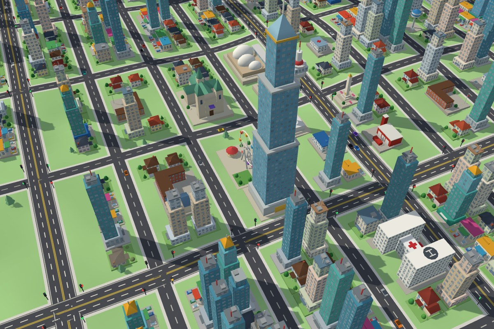

# Blocktown

A city builder in 3D that runs in the browser, made for [Toki](https://playtoki.app). In English and German, for phones and computers.

Draw roads (straight or curved, with bridges over water and tunnels through hills), paint zones and watch buildings grow, keep the power and water running, the traffic moving and the citizens happy, and crown the city with landmarks.



## What is in the game

- **Building:** a big build button fans out the categories; each opens a drawer of cards that show the buildings drawn from their own 3D models. With a finger, a road gets round handles to move its ends and bend it, and a tick button builds it; buildings and the bulldozer also wait for a tick next to the spot.
- **Roads:** streets, one-way streets, avenues, one-way avenues, tram avenues and highways at any angle, with curves. Roads over water become bridges; the tunnel switch digs straight under hills. Any crossing of three to six roads can become a roundabout. A highway crosses every map; a town only grows on roads that lead to it.
- **Zones:** houses, apartments, shops, shopping centres, industry, offices, and farms, forestry, mining and oil on the right land. Buildings grow by themselves when the city wants them and get better (three levels) where the land is worth more.
- **Power, water and sewage** run along the roads by themselves. Wind, coal, sun and nuclear power; pumps, water towers, septic tanks, outlets and treatment plants.
- **Services:** clinics and hospitals, schools up to a university, police, fire brigade, rubbish, parks. Each reaches the plots around it.
- **Traffic:** every car, lorry, bus and tram drives from a real building to a real building, takes the quickest way (one-way roads included), queues in its lane and waits at crossings. Busy crossings of big roads get traffic lights by themselves. Stuck drivers look for another way. Jams make people unhappy and businesses poorer.
- **Bus, tram and metro lines** the player draws stop by stop. Trams run on tram avenues and need a tram depot.
- **Landmarks:** ten of them, one of each per city, from the Founders' Column to the Space Centre. Each has its own powers (City Hall raises taxes, the Harbour boosts exports, the Airport brings more visitors) and they all draw visitors, who drive in over the highway and spend money.
- **Education and jobs:** schools decide how well schooled people are; offices need educated workers, factories don't.
- **Goods:** farms, forests, mines and oil fields feed the factories, the factories feed the shops; the rest comes and goes by lorry over the highway.
- **Day and night, weather and four seasons:** rain, fog, storms, snow; they change how much wind and sun power there is, how much heating is needed and how fast traffic is.
- **Disasters:** fires (fire engines drive out), floods of low land, storm damage. Never in chill mode, and they can be switched off.
- **Money:** taxes per kind of zone, a budget per service, loans.
- **Three modes:** *Chill* (endless money, everything unlocked, nothing bad happens, no high scores), *Normal* (things unlock at milestones) and *Hard* (little money, more disasters, bankruptcy).
- **Maps** are made from a code (a number or a word): the same code gives the same land, so friends can build on the same map.
- **Advisor:** a small box that says what to do next and what is going wrong.
- **Toki:** saves (Toki keeps what the game stores in the browser), a city score as the main high-score list plus five more lists, and 30 achievements. All of it is set up in [`toki.json`](toki.json). Saves from Blocktown 1.0 still load (a test checks a real 1.0 save).
- **Phones:** buildings and trees are drawn in pieces of the map that are only redrawn when something in them changes and skipped when out of sight; a battery saver (on by default on phones) draws at most 30 pictures a second.

## Putting it on Toki

1. On Toki, open **Add game** and choose **From GitHub** with this repository.
2. Toki sees that the game has to be built first and offers to add a workflow (`.github/workflows/toki.yml`) with a pull request. Accept it.
3. From then on every push to the branch puts the new version live. Title, descriptions, cover, screenshots, high-score lists and achievements come from `toki.json`. Raise `version` there (and write `notes` for players) when there is something new.

## Working on it

```sh
npm install
npm run dev        # the game at http://localhost:5173
npm test           # the tests
npm run typecheck
npm run build      # the finished game in dist/
```

`dev.html` (only while developing: `http://localhost:5173/dev.html?bot=120&mode=chill&q=high`) shows a city without the interface, built by the automatic mayor from the tests. Handy for looking at the graphics. `?gallery=1&size=medium` shows every landmark, `?roads=1&size=medium` the new roads (lights, roundabout, one-way streets, a tram line).

## How the code is laid out

- `src/sim/` is the simulation. It knows nothing about the screen, so it can be tested on its own.
  - `defs.ts`: every road, zone and building with its numbers. **Change the balance of the game here.**
  - `terrain.ts`: the land from a seed. `roads.ts`: the road network and the rules for new roads. `lots.ts`: the plots along roads.
  - `city.ts`: one city and everything the player can do to it. `economy.ts`: power and water, people and jobs, happiness, growth, money, once a game hour.
  - `traffic.ts`: vehicles, their lanes, traffic lights and how they find their way. `transit.ts`: bus, tram and metro lines. `maps.ts`: how far services reach, pollution, noise, land value.
  - `weather.ts`, `disasters.ts`, `progress.ts` (milestones, score, achievements), `save.ts` (a city packed small: Toki keeps at most 1 MB per game).
- `src/render/` draws the city with Three.js: `view.ts` (camera, sun, sky), `land.ts`, `roadsMesh.ts`, `lotsMesh.ts` and `blueprints.ts` (what every building looks like, made from a few simple shapes), `fx.ts` (vehicles, rain, snow, flames), `overlay.ts` (info views and tool previews), `thumbs.ts` (the pictures of buildings in the build menu).
- `src/input/`: `controls.ts` (mouse, keys, touch) and `tools.ts` (the building tools).
- `src/ui/`: the interface as plain page elements: `ui.ts` (top bar, build button and drawers, tool bar, things floating over the map), `panels.ts`, `menu.ts`, `icons.ts` (every icon, drawn as small SVG pictures), `style.css`. Fonts (Fredoka, Nunito) come from npm and are bundled. Texts are in `texts.en.ts` and `texts.de.ts`, always both (a test checks). German uses “ss” instead of “ß”.
- `src/audio/sound.ts`: all sounds are made in the browser, there are no sound files.
- `src/toki.ts`: sends scores and achievements to Toki. Outside Toki it does nothing.
- `tests/`: `bot.ts` is an automatic mayor that grows a city; `bot.test.ts` uses it to check the balance holds.

## Ideas for later

- Districts with their own rules, building together with friends through Toki's invites, animated landmarks (a turning big wheel, planes taking off), trains.
